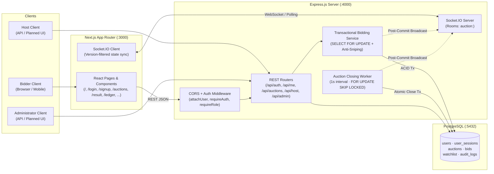
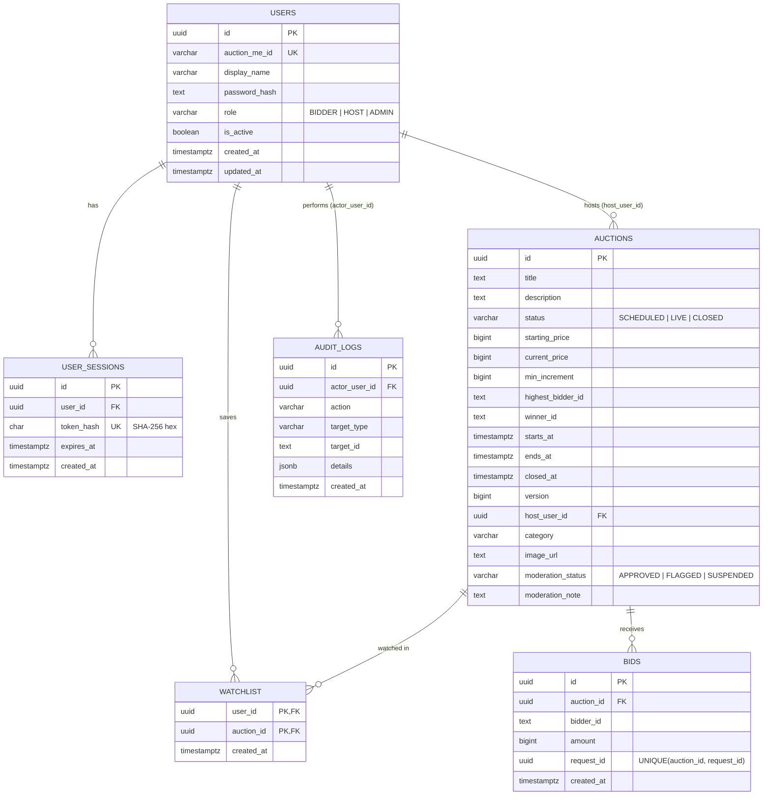

# AuctionMe — The Art of the Bid.

> A real-time, transaction-safe live online auction platform built with **Next.js (App Router)**, **React**, **Express.js**, **Socket.IO**, and **PostgreSQL**.

---

## Table of Contents

1. [Project Introduction](#1-project-introduction)
2. [Features by Role](#2-features-by-role)
3. [Technology Stack](#3-technology-stack)
4. [System Architecture](#4-system-architecture)
5. [Project Structure](#5-project-structure)
6. [Prerequisites](#6-prerequisites)
7. [Installation and Setup](#7-installation-and-setup)
8. [Environment Variables](#8-environment-variables)
9. [Database Design](#9-database-design)
10. [Demo Accounts and Seed Data](#10-demo-accounts-and-seed-data)
11. [Auction Workflow & Concurrency Engine](#11-auction-workflow--concurrency-engine)
12. [API Documentation](#12-api-documentation)
13. [Real-Time Communication (Socket.IO)](#13-real-time-communication-socketio)
14. [Testing](#14-testing)
15. [Troubleshooting](#15-troubleshooting)
16. [Security Considerations](#16-security-considerations)
17. [Limitations and Future Improvements](#17-limitations-and-future-improvements)
18. [Team / Academic Information](#18-team--academic-information)
19. [License](#19-license)

---

## 1. Project Introduction

**AuctionMe** (*The Art of the Bid.*) is a full-stack real-time online auction platform engineered for strict financial correctness under concurrent load.

### Problem Statement & Objectives
Online auctions face three classic distributed-systems failure modes:
1. **Race conditions during simultaneous bidding** — two users bidding at the same millisecond can overwrite each other or produce inconsistent prices without row-level serialization.
2. **Last-second sniping** — automated or last-second bids prevent fair price discovery unless the server enforces an authoritative deadline extension rule.
3. **Double-closing or multiple winners** — background expiry jobs racing with incoming bids can corrupt final outcomes unless closing is atomic.

### How Real-Time Bidding Works
- Clients load authoritative auction state over Express REST APIs and subscribe to auction-specific Socket.IO rooms (`auction:<auctionId>`).
- Every bid submission executes inside a PostgreSQL ACID transaction using `SELECT ... FOR UPDATE` and authoritative database time (`clock_timestamp()`).
- If a valid bid is accepted with `<= 30 seconds` remaining, the server atomically extends `ends_at` by 30 seconds.
- Socket.IO broadcasts committed updates **strictly after** PostgreSQL `COMMIT`, tagged with a monotonically increasing `version` so clients discard stale or out-of-order events.
- A background closing worker locks expired `LIVE` auctions using `FOR UPDATE SKIP LOCKED`, transitions them to `CLOSED`, and assigns exactly one `winner_id` (or `NULL` when no bids were accepted).

---

## 2. Features by Role

> Legend: **Implemented** = live in codebase; **Backend Only** = Express API implemented, dedicated UI screen planned; **UI Scaffold / Planned** = frontend screen built, backend API pending.

### Bidder
| Feature | Status | Notes |
|---|---|---|
| Registration & Login (`AuctionMe ID` + Password) | **Implemented** | `/login`, `/signup` UI + `/api/auth/register`, `/api/auth/login`, `/api/auth/check-id`, `/api/auth/logout`, `/api/auth/me` |
| Discover / Browse Auctions | **Implemented** | `/`, `/discover`, `/auctions` + `GET /api/auctions` |
| Live Auction Room & Real-Time Bidding | **Implemented** | `/`, `/auctions/[id]` + `POST /api/auctions/:id/bids` + Socket.IO |
| Auction Result & Winner Details | **Implemented** | `/result`, `/auctions/[id]/result` + `GET /api/auctions/:id/result` |
| Personal Bid History (My Ledger) | **Implemented** | `/ledger` UI + `GET /api/me/bids` (accepted bids; rejected bid persistence planned) |
| Won Auctions (My Holdings) | **Implemented** | `/holdings` + `GET /api/me/holdings` |
| Watchlist Management | **Implemented** | `/watchlist` + `GET/POST/DELETE /api/me/watchlist/:auctionId` |
| Notifications Center | **UI Scaffold / Planned** | `/notifications` UI built; backend `/api/notifications` persistence pending |
| Profile & Settings | **UI Scaffold / Planned** | `/settings` UI built (theme switching works locally); profile update & password change endpoints pending |
| Help & Support | **UI Scaffold / Planned** | `/help` searchable FAQs & rules work; `POST /api/support/tickets` backend pending |

### Host
| Feature | Status | Notes |
|---|---|---|
| Create & Edit Auctions | **Backend Only** | `POST /api/host/auctions`, `PATCH /api/host/auctions/:id` implemented; Host UI screens planned |
| Start & Manually Close Auctions | **Backend Only** | `POST /api/host/auctions/:id/start`, `POST /api/host/auctions/:id/close` implemented |
| List & Inspect Own Auctions | **Backend Only** | `GET /api/host/auctions`, `GET /api/host/auctions/:id` implemented |
| Monitor Live Bidding & Results | **Implemented** | Accessible via `/auctions/[id]` and `/auctions/[id]/result` |

### Administrator
| Feature | Status | Notes |
|---|---|---|
| User & Role Management | **Backend Only** | `GET /api/admin/users`, `PATCH /api/admin/users/:id/role`, `PATCH /api/admin/users/:id/status` implemented; Admin UI planned |
| Auction Moderation (`APPROVED`, `FLAGGED`, `SUSPENDED`) | **Backend Only** | `GET /api/admin/auctions`, `PATCH /api/admin/auctions/:id/moderate` implemented |
| Audit Logs | **Backend Only** | `GET /api/admin/audit-logs` + `audit_logs` table implemented |
| Complaints & Disputes | **Planned** | Designed in architecture; schema, API, and UI not yet implemented |

---

## 3. Technology Stack

Verified directly from `backend/package.json` and `frontend/package.json`:

| Layer | Technology | Version |
|---|---|---|
| **Frontend Framework** | Next.js (App Router) | `^15.1.7` (resolved `15.5.29`) |
| **UI Library** | React & React DOM | `^18.3.1` |
| **Styling** | Tailwind CSS + PostCSS + Autoprefixer | `^3.4.17` / `^8.4.49` / `^10.4.20` |
| **Language** | JavaScript (ES6+) | Node.js `v22+` |
| **Backend Runtime & API** | Node.js + Express.js + `cors` + `dotenv` | `express ^4.21.2`, `cors ^2.8.5`, `dotenv ^16.4.7` |
| **Database & Driver** | PostgreSQL + `pg` (node-postgres) | `pg ^8.13.1` (PostgreSQL 16+ / 18.6 tested) |
| **Real-Time Communication** | Socket.IO & `socket.io-client` | `^4.8.1` |
| **Auth & Password Hashing** | Node.js built-in `crypto.scryptSync` + `timingSafeEqual` + SHA-256 opaque session tokens (`HttpOnly` cookie / `Bearer` token) | Built-in Node.js `crypto` |
| **Testing Tools** | Node.js `assert` + native `fetch` against live PostgreSQL transactions | Built-in Node.js |
| **Dev & Containerization** | Docker Compose (`postgres:16-alpine`), `node --watch` | `docker-compose.yml` |

---

## 4. System Architecture



### Component Responsibilities
- **Next.js Frontend (`frontend/`):** Dedicated presentation layer using App Router and Tailwind CSS (no Next.js API routes). Synchronizes initial state via REST and applies real-time updates via Socket.IO while discarding stale event versions.
- **Express.js Backend (`backend/`):** Single authoritative HTTP API and Socket.IO server. Enforces authentication (`attachUser`, `requireAuth`), role-based authorization (`requireRole`), input validation, and centralized error handling.
- **Transactional Bidding Service (`biddingService.js`):** Serializes concurrent bids per auction using PostgreSQL row locks, checks idempotency via `(auction_id, request_id)`, validates minimum increments, and applies 30-second anti-sniping extensions using `clock_timestamp()`.
- **Auction Closing Worker (`closingWorker.js` + `closingService.js`):** Polls every `CLOSING_WORKER_INTERVAL_MS` (default `1000ms`), locks expired `LIVE` rows with `FOR UPDATE SKIP LOCKED`, and atomically finalizes `status = 'CLOSED'` and `winner_id`.
- **PostgreSQL (`schema.sql`):** Authoritative persistence for users, hashed sessions, auctions, bids, watchlists, and admin audit logs. All monetary amounts are stored as `BIGINT` integer paise (`100 paise = ₹1.00`).

---

## 5. Project Structure

```text
.
├── docker-compose.yml              # PostgreSQL 16 service definition
├── .env.example                    # Template environment variables
├── .gitignore
├── README.md
├── backend/
│   ├── package.json                # Express, pg, socket.io & npm scripts
│   ├── scripts/
│   │   ├── init-db.js              # Applies backend/src/database/schema.sql
│   │   ├── seed.js                 # Seeds demo users, live auction & initial bids
│   │   ├── concurrency-test.js     # 14-test transactional concurrency & closing suite
│   │   └── verify-api.js           # 10-test Auth, RBAC, Host, Bidder & Admin API suite
│   └── src/
│       ├── app.js                  # Express app, middleware & route mounting
│       ├── server.js               # HTTP server, Socket.IO attach & closing worker boot
│       ├── config/
│       │   ├── env.js              # Environment loader & defaults
│       │   └── db.js               # pg Pool configuration
│       ├── database/
│       │   ├── schema.sql          # Idempotent PostgreSQL DDL & indexes
│       │   └── init.js             # Programmatic schema initializer
│       ├── middleware/
│       │   └── auth.js             # Session extraction, requireAuth, requireRole
│       ├── routes/
│       │   ├── auth.js             # /api/auth/*
│       │   ├── auctions.js         # /api/auctions/*
│       │   ├── me.js               # /api/me/*
│       │   ├── host.js             # /api/host/*
│       │   └── admin.js            # /api/admin/*
│       ├── services/
│       │   ├── authService.js      # scrypt password hashing & opaque DB sessions
│       │   ├── auctionService.js   # Auction reads, bid history & results
│       │   ├── biddingService.js   # SELECT FOR UPDATE bidding & anti-sniping
│       │   ├── closingService.js   # FOR UPDATE SKIP LOCKED atomic closing
│       │   ├── bidderService.js    # Personal bids, holdings & watchlist
│       │   ├── hostService.js      # Host auction CRUD & lifecycle controls
│       │   ├── adminService.js     # Admin user/role, moderation & audit logs
│       │   └── helpers.js          # AppError, UUID validation & formatters
│       ├── sockets/
│       │   └── auctionSocket.js    # Room join/leave & post-commit emitters
│       └── workers/
│           └── closingWorker.js    # 1s interval expiry worker
└── frontend/
    ├── package.json                # Next.js 15, React 18, Tailwind CSS, socket.io-client
    ├── next.config.mjs
    ├── tailwind.config.js          # AuctionMe light/dark tokens & typography
    ├── postcss.config.mjs
    ├── public/images/              # Hero artwork (dark watch, light gavel)
    └── src/
        ├── app/                    # App Router pages:
        │   ├── page.js             # / (Live Auction / Catalog entry)
        │   ├── login/page.js       # /login (Screen 01)
        │   ├── signup/page.js      # /signup (Screen 02)
        │   ├── discover/page.js    # /discover (Catalog)
        │   ├── auctions/           # /auctions, /auctions/[id], /auctions/[id]/result
        │   ├── result/page.js      # /result (Screen 05 shortcut)
        │   ├── ledger/page.js      # /ledger (Screen 06)
        │   ├── holdings/page.js    # /holdings
        │   ├── watchlist/page.js   # /watchlist
        │   ├── notifications/      # /notifications (Screen 09)
        │   ├── settings/           # /settings (Screen 10)
        │   └── help/               # /help (Screen 11)
        ├── components/             # Modular UI components grouped by screen
        ├── hooks/                  # useAuctionSocket, useCatalogSocket, useThemePreference
        ├── services/               # api.js, authApi.js
        └── utils/                  # formatters.js, authValidation.js, ledgerUtils.js
```

---

## 6. Prerequisites

- **Node.js:** `v20.x` or `v22.x` (verified on `v22.23.2`)
- **npm:** `v10.x` (verified on `10.9.8`)
- **PostgreSQL:** `16+` (via Docker Compose **or** a local PostgreSQL installation; verified on PostgreSQL `18.6`)
- **Docker & Docker Compose** *(optional)*: required only if running PostgreSQL via `docker-compose.yml`
- **Git:** for cloning the repository

---

## 7. Installation and Setup

### 1. Clone the Repository
```bash
git clone <repository-url>
cd <repository-folder>
```

### 2. Install Backend Dependencies
```bash
cd backend
npm install
```

### 3. Install Frontend Dependencies
```bash
cd ../frontend
npm install
```

### 4. Start or Create the PostgreSQL Database

**Option A — Using Docker Compose (recommended on a fresh machine):**
```bash
# From the repository root
docker compose up -d postgres
```

**Option B — Using a Local PostgreSQL Instance:**
Create a role and database matching your `.env` configuration (for example, `auction_user` owning `live_auction`):
```sql
CREATE ROLE auction_user LOGIN PASSWORD '<choose-local-password>';
CREATE DATABASE live_auction OWNER auction_user;
```

### 5. Configure Environment Files
Copy `.env.example` to `backend/.env` and `frontend/.env.local`, then adjust values as needed (see [Section 8](#8-environment-variables)).

### 6. Initialize the Database Schema
```bash
cd backend
npm run db:init
```

### 7. Seed Demo Data
```bash
cd backend
npm run db:seed
```

### 8. Start the Backend Server (`http://localhost:4000`)
```bash
cd backend
npm run dev
# Or for production mode:
npm start
```

### 9. Start the Frontend Server (`http://localhost:3000`)
In a second terminal:
```bash
cd frontend
npm run dev
# Or for a verified production build:
npm run build
npm start
```

### 10. Open in Browser
- **Application Home / Live Auction:** http://localhost:3000
- **Login (Screen 01):** http://localhost:3000/login
- **Sign Up (Screen 02):** http://localhost:3000/signup
- **Auction Result (Screen 05):** http://localhost:3000/result
- **My Ledger (Screen 06):** http://localhost:3000/ledger
- **Notifications (Screen 09):** http://localhost:3000/notifications
- **Profile & Settings (Screen 10):** http://localhost:3000/settings
- **Help & Support (Screen 11):** http://localhost:3000/help
- **Backend Health Check:** http://localhost:4000/api/health

---

## 8. Environment Variables

Configure `backend/.env` and `frontend/.env.local` using `.env.example` as a template. **Never commit `.env`, `.env.local`, or real production credentials to Git** (already excluded in `.gitignore`).

| Variable | Scope | Purpose | Example Placeholder | Required |
|---|---|---|---|---|
| `POSTGRES_USER` | Docker Compose / Backend | PostgreSQL username | `your_db_user` | Optional (defaults in `env.js`) |
| `POSTGRES_PASSWORD` | Docker Compose / Backend | PostgreSQL password | `your_db_password` | Optional (required if not using `DATABASE_URL`) |
| `POSTGRES_DB` | Docker Compose / Backend | PostgreSQL database name | `live_auction` | Optional |
| `POSTGRES_PORT` | Docker Compose / Backend | PostgreSQL TCP port | `5432` | Optional |
| `DATABASE_URL` | Backend | Full PostgreSQL connection URI | `postgresql://<user>:<password>@localhost:5432/live_auction` | **Recommended / Required in prod** |
| `PORT` | Backend | Express HTTP & Socket.IO port | `4000` | Optional (default `4000`) |
| `NODE_ENV` | Backend | Runtime environment (`development` / `production`; enables `Secure` cookie flag in production) | `development` | Optional |
| `CORS_ORIGIN` | Backend | Comma-separated allowed frontend origin(s) | `http://localhost:3000` | **Required if frontend differs from `:3000`** |
| `CLOSING_WORKER_INTERVAL_MS` | Backend | Closing worker polling interval in milliseconds | `1000` | Optional (default `1000`) |
| `NEXT_PUBLIC_API_URL` | Frontend | Express REST API base URL | `http://localhost:4000` | **Required** |
| `NEXT_PUBLIC_SOCKET_URL` | Frontend | Express Socket.IO server URL | `http://localhost:4000` | **Required** |

---

## 9. Database Design

Defined in `backend/src/database/schema.sql`. All monetary values are stored in `BIGINT` integer paise (`₹25,000.00` = `2500000`).



### Key Constraints & Indexes
- **Auction Lifecycle:** `status` is constrained to `SCHEDULED`, `LIVE`, or `CLOSED`, with `CHECK (ends_at > starts_at)`.
- **Idempotency:** `bids` enforces `CONSTRAINT bids_auction_request_unique UNIQUE (auction_id, request_id)`.
- **Case-Insensitive Usernames:** `idx_users_auction_me_id_lower ON users (LOWER(auction_me_id))`.
- **Closing Worker Index:** `idx_auctions_status_ends_at ON auctions (status, ends_at)` accelerates expired auction discovery.
- **Bid History & Ledger Indexes:** `idx_bids_auction_created_at (auction_id, created_at DESC)`, `idx_bids_bidder_created_at (bidder_id, created_at DESC)`, and `idx_bids_request_id (request_id)`.
- **Winner Determination:** `winner_id` remains `NULL` while `LIVE` and is atomically set to `highest_bidder_id` (or stays `NULL` if zero bids) when `status` transitions to `CLOSED`.

---

## 10. Demo Accounts and Seed Data

Running `npm run db:seed` inside `backend/` executes `backend/scripts/seed.js`, which:
1. Initializes the schema if not already present.
2. Upserts four local development accounts (with `scrypt`-hashed passwords):
   - **Bidder:** `bidder-aarav-01`, `bidder-meera-02` (`role: BIDDER`)
   - **Host:** `host-curate-01` (`role: HOST`)
   - **Admin:** `admin-01` (`role: ADMIN`)
   *(Note: The current seed script uses these IDs rather than `demo_bidder` / `demo_host` / `demo_admin`. If your evaluation harness expects those exact aliases, update the `upsertUser` calls in `backend/scripts/seed.js`.)*
3. Deterministically resets and seeds one live auction (`11111111-1111-4111-8111-111111111111` — *1969 Grand Seiko Hi-Beat 36000 — Collector Edition*, starting at ₹25,000, current price ₹26,500, min increment ₹500, 5-minute window) with two initial bids.

### Safe Re-Seeding & Credential Hygiene
- Re-running `npm run db:seed` is safe and idempotent: users are upserted via `ON CONFLICT (auction_me_id) DO UPDATE`, and the demo auction (`11111111-...`) is cleanly reset with a fresh 5-minute countdown.
- **Local vs. Production:** Local seed credentials are defined inside `backend/scripts/seed.js` strictly for local assessment and are intentionally omitted from this README. In production, **never** run `seed.js` with hardcoded passwords—inject initial admin bootstrap credentials via environment variables (e.g., `SEED_ADMIN_PASSWORD`) or a secret manager, and rotate immediately.

---

## 11. Auction Workflow & Concurrency Engine

Every `POST /api/auctions/:id/bids` executes the following sequence inside `backend/src/services/biddingService.js`:

1. **Input Validation:** Validates `auctionId` (UUID), `bidderId` (non-empty string; overridden by `req.user.auctionMeId` when authenticated), `amount` (positive safe integer in paise), and `requestId` (UUID).
2. **`BEGIN` Transaction:** Acquires a dedicated client from the `pg` pool.
3. **Row Lock (`SELECT ... FOR UPDATE`):** Locks the target `auctions` row, serializing all competing bids and closing worker attempts for that auction.
4. **Authoritative Database Time:** Evaluates `clock_timestamp()` **after** lock acquisition (never trusts browser clocks) to compute `before_start`, `is_expired`, and `should_extend` (`(ends_at - db_now) <= INTERVAL '30 seconds'`).
5. **Idempotency Check:** Queries `bids` for `(auction_id, request_id)`. If already accepted, commits and returns `200 OK` (`idempotentReplay: true`) with the original bid record.
6. **Status & Window Validation:** Rejects if `SCHEDULED` / before `starts_at`, `CLOSED`, `SUSPENDED` (moderation), or `clock_timestamp() >= ends_at`.
7. **Minimum Increment Validation:** Rejects with `409 BID_TOO_LOW` if `amount < current_price + min_increment`.
8. **Commit Accepted Bid:** Inserts into `bids`, updates `current_price`, `highest_bidder_id`, increments `version`, and extends `ends_at` by `INTERVAL '30 seconds'` if `should_extend` is true.
9. **`COMMIT` & Post-Commit Broadcast:** Emits `auction:update` via Socket.IO **only after** `COMMIT` succeeds. Any rejection executes `ROLLBACK` cleanly.
10. **Atomic Closing (`closingService.js`):** Every second, the worker selects expired `LIVE` rows with `FOR UPDATE SKIP LOCKED` and atomically sets `status = 'CLOSED'`, `winner_id = highest_bidder_id`, `closed_at = clock_timestamp()`, and `version = version + 1`. A late bid racing with closure is resolved by the same row lock—if the bid commits first and extends `ends_at`, the worker will not close it.

---

## 12. API Documentation

All routes below are verified from `backend/src/app.js` and `backend/src/routes/*.js`.

### System & Health
| Method | Route | Purpose | Auth | Role |
|---|---|---|---|---|
| `GET` | `/api/health` | Check API & PostgreSQL connectivity + `serverTime` | Public | Any |

### Authentication (`/api/auth`)
| Method | Route | Purpose | Auth | Role | Request Body / Query |
|---|---|---|---|---|---|
| `GET` | `/api/auth/check-id` | Check if an `auctionMeId` is available | Public | Any | Query: `?auctionMeId=<id>` |
| `POST` | `/api/auth/register` | Register a new `BIDDER` account & set `HttpOnly` cookie | Public | Public (always creates `BIDDER`) | `{ displayName, auctionMeId, password }` |
| `POST` | `/api/auth/login` | Authenticate with `AuctionMe ID` + password | Public | Any | `{ auctionMeId, password, rememberMe }` |
| `POST` | `/api/auth/logout` | Revoke session token & clear cookie | Public / Session | Any | — |
| `GET` | `/api/auth/me` | Return authenticated user profile | Required | Any | — |

### Public & Bidding Auctions (`/api/auctions`)
| Method | Route | Purpose | Auth | Role | Request Body |
|---|---|---|---|---|---|
| `GET` | `/api/auctions` | List auctions (`LIVE` first) with `bidCount` & `serverTime` | Public | Any | — |
| `GET` | `/api/auctions/:id` | Get authoritative single auction state | Public | Any | — |
| `GET` | `/api/auctions/:id/bids` | List accepted bids (`?limit=50`, newest first) | Public | Any | — |
| `POST` | `/api/auctions/:id/bids` | Place transaction-safe bid (paise) | Optional* | `BIDDER` (when authenticated; `HOST` blocked) | `{ bidderId, amount, requestId, socketId? }` |
| `GET` | `/api/auctions/:id/result` | Get authoritative auction outcome & winner | Public | Any | — |

*\*When a valid session cookie or `Bearer` token is present, the server uses `req.user.auctionMeId` as the authoritative bidder ID and ignores client-supplied `bidderId`.*

**Example `POST /api/auctions/:id/bids` Response (`201 Created`):**
```json
{
  "accepted": true,
  "idempotentReplay": false,
  "extended": true,
  "extensionSeconds": 30,
  "bid": { "id": "...", "auctionId": "...", "bidderId": "bidder-aarav-01", "amount": 2700000, "requestId": "..." },
  "auction": { "id": "...", "status": "LIVE", "currentPrice": 2700000, "minNextBid": 2750000, "version": 4, "endsAt": "..." },
  "serverTime": "2026-11-27T07:08:42.157Z"
}
```
**Common Error Responses:** `400` (`INVALID_BID_AMOUNT`, `INVALID_AUCTION_ID`, `INVALID_REQUEST_ID`), `401` (`UNAUTHENTICATED`), `403` (`FORBIDDEN`), `404` (`AUCTION_NOT_FOUND`), `409` (`BID_TOO_LOW`, `AUCTION_NOT_STARTED`, `AUCTION_EXPIRED`, `AUCTION_CLOSED`, `AUCTION_ME_ID_TAKEN`).

### Bidder Personal Endpoints (`/api/me`)
| Method | Route | Purpose | Auth | Role |
|---|---|---|---|---|
| `GET` | `/api/me/bids` | Authenticated user's accepted bid history (`?limit=`) | Required | Any |
| `GET` | `/api/me/holdings` | Auctions won by the authenticated user | Required | Any |
| `GET` | `/api/me/watchlist` | Authenticated user's saved watchlist | Required | Any |
| `POST` | `/api/me/watchlist/:auctionId` | Add auction to watchlist | Required | Any |
| `DELETE` | `/api/me/watchlist/:auctionId` | Remove auction from watchlist | Required | Any |

### Host Endpoints (`/api/host`)
| Method | Route | Purpose | Auth | Role |
|---|---|---|---|---|
| `POST` | `/api/host/auctions` | Create a new auction | Required | `HOST`, `ADMIN` |
| `GET` | `/api/host/auctions` | List auctions owned by the host | Required | `HOST`, `ADMIN` |
| `GET` | `/api/host/auctions/:id` | Get details of a host-owned auction | Required | `HOST`, `ADMIN` |
| `PATCH` | `/api/host/auctions/:id` | Update editable metadata (cannot tamper with `currentPrice` or `winnerId`) | Required | `HOST`, `ADMIN` |
| `POST` | `/api/host/auctions/:id/start` | Transition `SCHEDULED` auction to `LIVE` | Required | `HOST`, `ADMIN` |
| `POST` | `/api/host/auctions/:id/close` | Close an owned auction atomically & broadcast `auction:closed` | Required | `HOST`, `ADMIN` |

### Admin Endpoints (`/api/admin`)
| Method | Route | Purpose | Auth | Role |
|---|---|---|---|---|
| `GET` | `/api/admin/users` | List all registered users | Required | `ADMIN` |
| `PATCH` | `/api/admin/users/:id/role` | Update user role (`BIDDER`, `HOST`, `ADMIN`) | Required | `ADMIN` |
| `PATCH` | `/api/admin/users/:id/status` | Activate or deactivate a user account | Required | `ADMIN` |
| `GET` | `/api/admin/auctions` | List all auctions across all hosts | Required | `ADMIN` |
| `PATCH` | `/api/admin/auctions/:id/moderate` | Set `moderationStatus` (`APPROVED`, `FLAGGED`, `SUSPENDED`) + note | Required | `ADMIN` |
| `GET` | `/api/admin/audit-logs` | Retrieve admin audit trail (`?limit=`) | Required | `ADMIN` |

### Missing / Planned Endpoints (Not Implemented Yet)
- Notifications feed & read markers (`GET /api/notifications`, `PATCH /api/notifications/:id/read`, `POST /api/notifications/read-all`)
- Profile update & password change (`PATCH /api/me`, `POST /api/auth/change-password`, `GET/PATCH /api/me/preferences`)
- Support ticket submission (`POST /api/support/tickets`)
- Disputes / complaints management endpoints

---

## 13. Real-Time Communication (Socket.IO)

Implemented in `backend/src/sockets/auctionSocket.js` and consumed by `frontend/src/hooks/useAuctionSocket.js`.

- **Connection:** Socket.IO attaches directly to the Express HTTP server (`http://localhost:4000`) with CORS configured from `CORS_ORIGIN`.
- **Room Naming:** `auction:<auctionId>` (validated as UUID before joining).
- **Events:**
  - `auction:join` *(Client → Server)*: `{ auctionId }` — joins room `auction:<auctionId>` and acknowledges `{ ok, room, socketId }`.
  - `auction:leave` *(Client → Server)*: `{ auctionId }` — leaves room on unmount.
  - `auction:update` *(Server → Room, post-commit only)*: `{ auction, bid, version, extended, extensionSeconds, previousEndsAt, serverTime }`.
  - `auction:closed` *(Server → Room, post-commit only)*: `{ auction, auctionId, status: 'CLOSED', winnerId, finalPrice, closedAt, hadBids, version, serverTime }`.
  - `bid:rejected` *(Server → Submitting Socket)*: `{ auctionId, bidderId, requestId, code, message, details, timestamp }`.
- **Version Synchronization & Reconnection:** The frontend tracks `versionRef.current` and ignores any event where `payload.version <= versionRef.current`. On reconnect, `useAuctionSocket` automatically re-joins the room and triggers a fresh REST fetch to recover any state missed while disconnected.

---

## 14. Testing

### Available Test Suites & Commands

1. **Concurrency, Anti-Sniping & Closing Suite (`backend/scripts/concurrency-test.js`):**
   ```bash
   cd backend
   npm run test:concurrency
   ```
   - **Coverage (14 tests):** Simultaneous identical competing bids (5 concurrent HTTP requests → 1 accepted, 4 rejected, 1 DB row), simultaneous different bids (higher bid never overwritten), below minimum increment, equal to current price, zero/negative/decimal/string amounts, duplicate `requestId` (concurrent & sequential idempotent replay), bid before start, bid at/after expiration, anti-sniping (`<= 30s` extends by exactly 30s; `> 30s` and rejected bids do not extend), 5 concurrent closing worker runs (closes once with 1 winner), no-bids close (`winnerId: null`), and bid-vs-closing race safety.
   - **Last Executed Result:** **14/14 passed, 0 failed**.

2. **Auth, RBAC, Host, Bidder & Admin API Verification (`backend/scripts/verify-api.js`):**
   ```bash
   cd backend
   node scripts/verify-api.js
   ```
   - **Coverage (10 tests):** `/api/health`, registration with `scrypt` hashing & forced `BIDDER` role (ignores client-supplied `role: 'ADMIN'`), case-insensitive duplicate `auctionMeId` rejection (`409`), login/wrong-password rejection (`401`), unauthenticated blocking (`401`), RBAC enforcement (`403` for `BIDDER` on Host/Admin routes and `HOST` on Admin/Bidding routes), Host auction lifecycle & price/winner tamper protection, authenticated bidding + `/api/me/bids`, `/api/me/holdings`, `/api/me/watchlist`, and Admin moderation (`SUSPENDED` blocks bidding) + audit logs.
   - **Last Executed Result:** **10/10 passed, 0 failed**.

3. **Frontend Production Build Verification:**
   ```bash
   cd frontend
   npm run build
   ```
   - **Last Executed Result:** Compiled cleanly (`15/15` routes built with 0 errors).

---

## 15. Troubleshooting

| Issue | Likely Cause | Resolution |
|---|---|---|
| `ECONNREFUSED` on port `5432` | PostgreSQL is not running | Run `docker compose up -d postgres` or start your local PostgreSQL service. |
| `EADDRINUSE` on port `3000` or `4000` | Another Node/Next.js process is using the port | Stop the conflicting process or change `PORT` in `backend/.env`. |
| `password authentication failed` | `DATABASE_URL` credentials mismatch | Verify `DATABASE_URL` in `backend/.env` matches your Docker or local PostgreSQL role/password. |
| `relation "auctions" does not exist` | Schema not initialized | Run `cd backend && npm run db:init`. |
| Frontend cannot reach backend / CORS error | `CORS_ORIGIN` or `NEXT_PUBLIC_API_URL` mismatch | Ensure `CORS_ORIGIN=http://localhost:3000` in `backend/.env` and `NEXT_PUBLIC_API_URL=http://localhost:4000` in `frontend/.env.local`. |
| Socket.IO stays `Reconnecting...` | Backend stopped or `NEXT_PUBLIC_SOCKET_URL` wrong | Confirm Express is running on `:4000` and `NEXT_PUBLIC_SOCKET_URL=http://localhost:4000`. |
| `ENOENT` in `frontend/.next` during `npm run build` | `next dev` running concurrently while building | Stop `next dev`, remove `frontend/.next`, and re-run `npm run build`. |
| `401 UNAUTHENTICATED` on protected endpoints | Missing cookie or `Bearer` token | Sign in via `POST /api/auth/login` (with `credentials: 'include'` in browser or `Authorization: Bearer <token>` in CLI). |

---

## 16. Security Considerations

### Implemented Protections
- **Password Hashing:** Salted `crypto.scryptSync` (`scrypt$<16-byte-hex-salt>$<64-byte-hex-key>`) verified with `crypto.timingSafeEqual`—plaintext passwords are never stored.
- **Session Security:** Opaque 32-byte random tokens stored as SHA-256 hashes in `user_sessions`, delivered via `HttpOnly`, `SameSite=Lax` cookies (`Secure` when `NODE_ENV=production`) or `Bearer` tokens.
- **Backend RBAC:** `requireAuth` and `requireRole(...)` enforce `BIDDER`, `HOST`, and `ADMIN` access on the server; public registration always assigns `BIDDER` and ignores client-supplied roles.
- **SQL Parameterization:** Every PostgreSQL query uses parameterized placeholders (`$1`, `$2`, ...) via `pg`—no string interpolation in SQL.
- **Transactional Integrity & Idempotency:** `SELECT ... FOR UPDATE`, `FOR UPDATE SKIP LOCKED`, `clock_timestamp()`, and `UNIQUE (auction_id, request_id)` prevent race conditions, duplicate bids, and double-closing.
- **Input Validation & Secret Hygiene:** Strict UUID, integer paise, and string length validation; `.env` files excluded via `.gitignore`.

### Not Yet Implemented (Production Hardening Roadmap)
- HTTP rate limiting & brute-force login throttling.
- CSRF tokens (mitigated partially by `SameSite=Lax`, not yet full double-submit CSRF).
- Helmet security headers & Content Security Policy (CSP).

---

## 17. Limitations and Future Improvements

### Currently Implemented
- Full transactional PostgreSQL bidding engine with `SELECT ... FOR UPDATE`, idempotency, 30s anti-sniping, and atomic `FOR UPDATE SKIP LOCKED` closing worker.
- Real-time Socket.IO auction rooms with monotonic version filtering and reconnect re-sync.
- Auth (`scrypt` + DB sessions), RBAC (`BIDDER` / `HOST` / `ADMIN`), Bidder personal APIs (`/api/me/*`), Host lifecycle APIs (`/api/host/*`), and Admin moderation/audit APIs (`/api/admin/*`).
- Responsive Light/Dark/System Next.js frontend screens (Login, Sign Up, Discover/Catalog, Live Auction Room, Auction Result, My Ledger, My Holdings, Watchlist, Notifications, Settings, Help & Support).

### Planned Improvements
- **Frontend UI Wiring:** Connect Host management screens, Admin moderation/audit UI, and wire `/signup` & `/ledger` directly to the newly added `/api/auth/register` and `/api/me/bids` endpoints.
- **Additional Backend APIs:** Notifications persistence (`/api/notifications`), profile/password updates (`PATCH /api/me`, `POST /api/auth/change-password`), support ticket intake (`/api/support/tickets`), rejected-bid audit table, and participant/extension counters on `/api/auctions/:id/result`.
- **Horizontal Scaling:** Multi-instance API & Socket.IO gateways with `@socket.io/redis-streams-adapter`, PgBouncer connection pooling, partial indexes + time-partitioned `bids` tables, distributed closing workers backed by a Redis `ZSET` delay queue, and OpenTelemetry/Prometheus observability.

---

## 18. Team / Academic Information

| Field | Details |
|---|---|
| **Student Name(s)** | `[Enter Student Name(s)]` |
| **Enrollment Number(s)** | `[Enter Enrollment Number(s)]` |
| **Institution** | `[Enter University / College Name]` |
| **Department** | `[Enter Department Name]` |
| **Project Guide / Mentor** | `[Enter Guide Name]` |
| **Academic Year** | `[Enter Academic Year, e.g., 2025–2026]` |

---

## 19. License

No license file (`LICENSE`) is currently specified in this repository. All rights reserved by the repository authors until a license is explicitly added.
